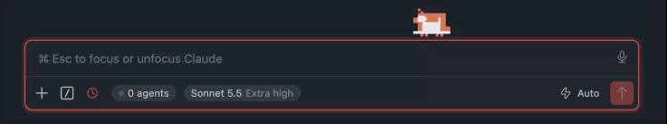

# Claude Octopus

*Unofficial.* A tiny pixel Claude that sits on top of the Claude Code chat box and shows how much of your Claude usage quota is left.

## Getting started

1. Install **Claude Octopus** from the Extensions view.
2. Use Claude Code as usual (the VS Code panel or `claude` in the terminal).
3. The mascot appears on the chat box. Hover over it to see your quota; drag it to move it.

No sign-in, nothing to configure.

## What it shows

| You see | It means |
|---|---|
| Strolling, football, music, chill, weights | Claude is idle, plenty of quota |
| Coding on a laptop, with coffee or sunglasses | Claude is working |
| A green **$** or an icon (📄 💻 🔍 💬…) falls into its mouth | Claude answered, read a file, ran a command… |
| Heavy eyelids and sweat | 80% of your quota used |
| A red empty battery | 95% used |
| Asleep under a nightcap, then a stretch | Session or weekly limit hit, until it resets |
| Lifting weights at 16:45 | Time for the gym! |

The status bar shows your quota too. Run **Claude Octopus: Preview Mascot State** to see any animation.

## Settings

| Setting | Default | |
|---|---|---|
| `claudeOctopus.location` | `floating` | `floating` (macOS), `activitybar`, `explorer`, `panel` or `hidden` |
| `claudeOctopus.eyes` | `white` | `white` or `black` |
| `claudeOctopus.gymReminder` | `16:45` | Daily gym reminder; empty turns it off |
| `claudeOctopus.size` | `1` | Size of the mascot (0.3 to 2) |

Click the mascot to run `/compact` once the conversation is past 75% full. Hold `Option` to click through it.

## Privacy

Everything stays on your machine: no network. It only reads the usage numbers and session history Claude Code already keeps locally, and never shows your messages.

## Requirements

VS Code 1.85+ and Claude Code. The floating mascot needs macOS; other systems get the classic octopus tank in the Activity Bar.

---

Not affiliated with or endorsed by Anthropic. Claude and Claude Code are trademarks of Anthropic, PBC.
